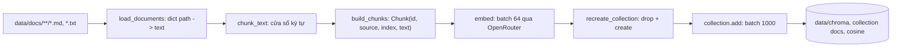
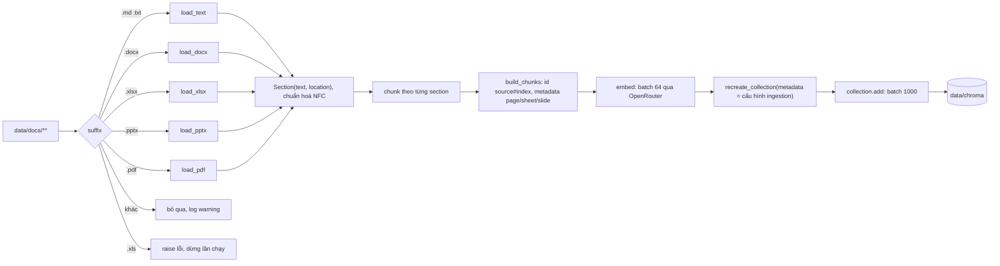

# Thiết kế ingestion pipeline

Tài liệu gồm hai phần. Phần đầu mô tả thiết kế hiện tại của `ingestion/` tại commit `a91fcbb`: đọc tài liệu trong `data/docs/`, cắt chunk, embed qua OpenRouter và ghi lại toàn bộ collection Chroma ở `data/chroma`. Phần sau là các thay đổi đã được người dùng chốt ngày 2026-10-19 qua hai vòng trả lời: lớp loader theo định dạng (Word, Excel, PowerPoint, PDF) với thư viện đã duyệt, phạm vi Excel tối thiểu kèm lỗi rõ ràng, chuẩn hoá Unicode NFC, và ghi cấu hình ingestion vào metadata collection. Các thay đổi này chưa được implement, các thư viện chưa được cài.

## Bối cảnh và phạm vi

Repo có hai pipeline độc lập, chỉ chia sẻ Chroma store trên đĩa: ingestion ghi, retrieval đọc (`README.md`, `CLAUDE.md`). Ingestion là batch job chạy tay bằng `uv run --env-file .env python main.py ingest`, mỗi lần chạy build lại toàn bộ collection. Corpus hiện có 3 file Markdown tiếng Việt về chính sách nhân sự (`data/docs/nghi-phep.md`, `data/docs/lam-viec-tu-xa.md`, `data/docs/cong-tac-phi.md`), mỗi file dưới 800 ký tự nên mỗi file thành đúng một chunk với cấu hình mặc định (`evaluation/reports/ingestion.json`: `"documents": 3`, `"expected_chunks": 3`).

Giả định lập kế hoạch: corpus thật sẽ do người dùng cung cấp sau, khoảng 10 văn bản, gồm các định dạng `.md`, `.txt`, `.docx`, `.xlsx`, `.pptx`, `.pdf`. Số chunk của corpus đó là (pending) cho tới khi có dữ liệu và chạy `ingestion_eval`.

Ngoài phạm vi: retrieval và sinh câu trả lời (xem `docs/plans/2026-10-19-retrieval-pipeline-design.md`), OCR (corpus thật không có PDF scan), định dạng Excel cũ `.xls`, ingestion tăng dần, chạy đồng thời với retrieval.

## Quyết định đã chốt

| Chủ đề | Quyết định của người dùng | Ảnh hưởng tới thiết kế |
| --- | --- | --- |
| Kích thước corpus | khoảng 10 văn bản, dữ liệu sẽ cung cấp sau | giữ full rebuild, giữ vector trong RAM; hash theo file vẫn là `# ponytail` |
| Định dạng đầu vào | `.md`, `.txt`, `.docx`, `.xlsx`, `.pptx`, `.pdf` | thêm lớp loader, mỗi đuôi file một loader, dispatch theo suffix |
| Chạy đồng thời | ingestion và retrieval không bao giờ chạy cùng lúc | race giữa hai pipeline không được xử lý, ghi thành quy tắc vận hành |
| Cấu hình trong store | ghi `EMBED_MODEL`, `chunk_size`, `chunk_overlap` và id chiến lược chunk vào metadata collection | retrieval đọc và dừng sớm khi lệch `EMBED_MODEL` |
| Unicode | chuẩn hoá text về NFC | áp dụng cho mọi loader, không chỉ PDF |
| Thư viện loader | duyệt `python-docx`, `openpyxl`, `python-pptx`, `pypdf`; chấp nhận `PyMuPDF` (AGPL) làm fallback nếu `pypdf` làm hỏng tiếng Việt | thêm vào `pyproject.toml` khi implement |
| PDF scan | corpus thật không có PDF scan | OCR ngoài phạm vi; giữ warning cho trang không có text layer như một kiểm tra an toàn |
| Excel | chỉ hỗ trợ trường hợp cơ bản, ghi rõ giới hạn | trường hợp không hỗ trợ mà phát hiện được thì raise lỗi nêu file, sheet, lý do, và dừng cả lần chạy |
| PowerPoint | đưa speaker notes vào chunk | mỗi slide: text slide rồi notes, có nhãn phân biệt |
| Hết quota | quota là giới hạn ngày của model free tier; hết quota thì dừng ngay với lỗi rõ ràng, không retry vô hạn | mục "Rate limit, hết quota và exit code" |
| Prefix embed | thêm `passage: ` trước text khi embed theo model card, ghi prefix vào metadata collection | mục "Embed model: giới hạn đầu vào và prefix" |

## Câu hỏi làm rõ và câu trả lời từ code

Quy trình brainstorming yêu cầu làm rõ mục đích, ràng buộc và tiêu chí thành công trước khi chốt thiết kế. Các câu dưới đây được trả lời từ code, README, CLAUDE.md, test và report; câu nào code không trả lời được nằm ở mục "Câu hỏi mở".

| Câu hỏi | Trả lời | Nguồn |
| --- | --- | --- |
| Ingestion chạy theo kiểu gì? | Batch, đồng bộ, build lại toàn bộ collection mỗi lần | `ingestion/pipeline.py:54-72` |
| Hiện hỗ trợ định dạng nào? | `.md`, `.txt`, so khớp đuôi không phân biệt hoa thường, quét đệ quy | `ingestion/pipeline.py:11`, `ingestion/pipeline.py:24-26` |
| Cắt chunk thế nào? | Cửa sổ ký tự cố định `chunk_size`, chồng lấn `chunk_overlap` | `ingestion/pipeline.py:30-41` |
| Chunk id ổn định theo gì? | `<path relative to data/docs>#<index>` | `ingestion/pipeline.py:47` |
| Embed bằng model nào? | `EMBED_MODEL` trong `.env` (`.env.example`: `nvidia/nemotron-3-embed-1b:free`) qua OpenRouter | `core.py:110`, `core.py:16` |
| Model embed nhận tối đa bao nhiêu token, có cần prefix không? | 32768 token; cần `passage: ` cho tài liệu và `query: ` cho câu hỏi | mục "Embed model: giới hạn đầu vào và prefix" |
| OpenAI SDK có tự retry không? | Có, mặc định 2 lần, retry cả 429 và 5xx (openai 3.3.0) | `.venv/lib/python3.12/site-packages/openai/_constants.py:8-13`, `.venv/lib/python3.12/site-packages/openai/_base_client.py:826-866` |
| Khi API lỗi thì index cũ ra sao? | Còn nguyên, vì embed xong mới drop collection | `ingestion/pipeline.py:58-61` |
| Tiêu chí "ingestion đúng" là gì? | Hiện tại: `ingestion_eval` pass, tức store khớp với lần chunk mới của docs và phủ mọi source trong golden set. Sau thay đổi: thêm khớp `corpus_hash` và mọi gold evidence khớp được ít nhất một chunk | `evaluation/ingestion_eval.py:51-57` |
| Có ràng buộc quota không? | Có, model free tier của OpenRouter | `CLAUDE.md`, `.env.example` |
| Chroma có lưu được metadata cấp collection không? | Có, `create_collection(..., metadata=...)` và thuộc tính `collection.metadata` trong chromadb 1.5.9 đang cài | `.venv/lib/python3.12/site-packages/chromadb/api/client.py:176-181`, `.venv/lib/python3.12/site-packages/chromadb/api/models/CollectionCommon.py:167-169` |

## Luồng dữ liệu

Luồng hiện tại:



Luồng sau thay đổi đã chốt:



Thứ tự embed trước, drop sau là bất biến của thiết kế: mọi lỗi trong bước embed xảy ra khi collection cũ chưa bị đụng tới (`ingestion/pipeline.py:58`, `CLAUDE.md`). Lớp loader chạy trước bước embed, nên file hỏng hoặc không đọc được cũng không làm mất index cũ.

## Thành phần hiện tại

| Thành phần | Trách nhiệm | Phụ thuộc | Vị trí |
| --- | --- | --- | --- |
| `main` | Parse `--docs` (mặc định `data/docs`), load settings, nối các bước, log số chunk | settings, openrouter, pipeline | `main.py:22-41` |
| `load_documents` | Đọc mọi file hỗ trợ dưới `docs_dir` bằng UTF-8, key là path POSIX tương đối, sắp xếp theo path | filesystem | `ingestion/pipeline.py:24-26` |
| `chunk_text` | Cắt text thành các cửa sổ tối đa `size` ký tự, bước nhảy `size - overlap`, `strip()` và bỏ cửa sổ rỗng | không | `ingestion/pipeline.py:30-41` |
| `build_chunks` | Gán id `source#index` cho từng chunk | `load_documents`, `chunk_text` | `ingestion/pipeline.py:45-50` |
| `ingest` | Từ chối input rỗng, embed toàn bộ, tạo lại collection, add theo batch, trả về `collection.count()` | `Embedder`, `recreate_collection` | `ingestion/pipeline.py:54-72` |
| `make_embedder` | Embed theo batch 64, sắp xếp kết quả theo `index` của response | client OpenAI trỏ tới OpenRouter | `core.py:189-201` |
| `recreate_collection` | Xoá collection nếu có, tạo mới với `hnsw.space = cosine`, không gắn embedding function | chromadb | `core.py:236-245` |
| `load_settings` | Đọc env và `config.yaml` một lần, từ chối key thiếu hoặc lạ, kiểm tra `0 <= chunk_overlap < chunk_size` | env, `config.yaml` | `core.py:75-127` |

`ingest` nhận `Embedder` là một callable (`core.py:71`), nên test thay bằng `fake_embed` (`tests/conftest.py:14-15`) mà không gọi mạng.

## Lớp loader theo định dạng

### Giao diện

Mỗi loader là một function nhận `Path` và trả danh sách section theo thứ tự trong file. Một section là một đơn vị không bị chunk vượt qua: một trang PDF, một slide, một nhóm dòng của một sheet, hoặc cả file với `.md`/`.txt`/`.docx`.

```python
@dataclass(frozen=True)
class Section:
    text: str
    location: dict[
        str, str | int
    ]  # vd {"page": 3}, {"sheet": "Q1"}, {"slide": 5}, rỗng với md/txt/docx
```

Dispatch bằng một dict `suffix -> loader` thay cho `SUPPORTED_SUFFIXES` ở `ingestion/pipeline.py:11`. `load_documents` đổi kiểu trả về từ `dict[str, str]` sang `dict[str, list[Section]]`, chuẩn hoá NFC (`unicodedata.normalize("NFC", text)`) ở một chỗ cho mọi loader, và bỏ qua file có đuôi không nằm trong dict kèm một dòng log warning liệt kê file bị bỏ qua (hiện tại bỏ qua im lặng). Bỏ qua cả file khoá tạm của Office có tên bắt đầu bằng `~$`.

`build_chunks` cắt từng section riêng rồi đánh index liên tục trong cả file, nên chunk id giữ nguyên dạng `<path relative to data/docs>#<index>`. Metadata chunk thêm các khoá trong `location` khi có:

| Khoá | Kiểu | Có ở định dạng |
| --- | --- | --- |
| `source` | str | mọi định dạng (giữ nguyên hợp đồng với golden set và retrieval) |
| `index` | int | mọi định dạng |
| `page` | int, bắt đầu từ 1 | `.pdf` |
| `sheet` | str | `.xlsx` |
| `slide` | int, bắt đầu từ 1 | `.pptx` |

Khoá nào không áp dụng thì không ghi, thay vì ghi giá trị rỗng. `ingestion_eval` dùng lại `build_chunks`, nên nó tự dùng cùng lớp loader và vẫn không gọi API.

### Thư viện

Người dùng đã duyệt danh sách dưới đây. Hiện chưa thư viện nào có trong `.venv` hay `uv.lock`; việc thêm vào `pyproject.toml` và `uv sync` thuộc bước implement.

| Định dạng | Thư viện | License | Chi phí |
| --- | --- | --- | --- |
| `.docx` | `python-docx` | MIT | dependency mới, kéo theo `lxml` (có binary wheel) |
| `.xlsx` | `openpyxl` | MIT | dependency mới, pure Python |
| `.pptx` | `python-pptx` | MIT | dependency mới, kéo theo `lxml`, `Pillow`, `XlsxWriter` (danh sách dependency chưa kiểm tra trên máy này, unverified); `Pillow` đã có trong `uv.lock` qua dependency khác |
| `.pdf` | `pypdf` | BSD | dependency mới, pure Python, không cần binary |
| `.pdf` (fallback đã chấp nhận) | `PyMuPDF` | AGPL-3.0 hoặc license thương mại | trích xuất text thường tốt hơn với font nhúng, nhưng AGPL ràng buộc cách phân phối code, wheel kèm binary MuPDF nên nặng hơn; người dùng đã chấp nhận license; chỉ chuyển sang khi `pypdf` cho text tiếng Việt hỏng trên mẫu PDF thật, và chỉ cài khi đó |

Không đề xuất các bộ chuyển đổi đa định dạng kiểu `unstructured`: kéo nhiều dependency cho 4 định dạng mà 4 thư viện nhỏ ở trên đã đủ.

### Đặc thù từng định dạng

`.md`, `.txt`: giữ như hiện tại, một section cho cả file. Chunk theo `chunk_text`.

`.docx`: đọc paragraph và bảng theo đúng thứ tự trong body (python-docx tách `paragraphs` và `tables` thành hai danh sách, nên phải duyệt phần tử body để giữ thứ tự). Mỗi dòng bảng nối các ô bằng ` | `. Bỏ header, footer, comment và text box. Một section cho cả file, chunk theo `chunk_text`. Tên style heading (`Heading 1`...) là dữ liệu sẵn có nếu sau này cần splitter theo heading.

`.xlsx`: đơn vị là dòng, chỉ hỗ trợ trường hợp cơ bản (xem mục "Excel: phạm vi và giới hạn"). Mỗi sheet là một chuỗi section; mỗi dòng được viết thành `Sheet <tên>: <header 1>: <giá trị 1>; <header 2>: <giá trị 2>...` để header lặp lại trong mọi chunk, vì một dòng tách khỏi header không còn nghĩa khi retrieve. Gom các dòng liên tiếp tới tối đa `chunk_size` ký tự, không cắt giữa dòng; chỉ khi một dòng đơn lẻ dài hơn `chunk_size` mới cắt bằng `chunk_text`. Overlap không áp dụng giữa các dòng. Bỏ dòng trống hoàn toàn.

`.pptx`: một section mỗi slide, metadata `slide`. Text slide gồm title rồi các text frame theo thứ tự shape, duyệt vào group shape, và bảng như `.docx`. Sau text slide là speaker notes, mở đầu bằng nhãn `Ghi chú:` để người đọc và model phân biệt được phần nào nằm trên slide, phần nào là notes; slide không có notes thì không có nhãn. Text slide và notes nằm cùng một section, nên cùng metadata `slide`. Slide thường ngắn hơn `chunk_size` nên thường một chunk mỗi slide; slide dài thì `chunk_text` trong slide đó. Slide không có cả text lẫn notes thì không sinh chunk.

`.pdf`: một section mỗi trang, metadata `page`. Corpus thật không có PDF scan nên OCR ngoài phạm vi. Trang không có text layer vẫn được xử lý như một kiểm tra an toàn: không sinh chunk, log warning kèm số trang, và `ingestion_eval` báo số trang như vậy. Text tiếng Việt trích từ PDF có thể ở dạng NFD hoặc dấu bị tách; NFC sửa được trường hợp dấu tổ hợp, không sửa được font nhúng thiếu bảng ánh xạ Unicode (ra ký tự sai hẳn). Trường hợp sau phải kiểm tra trên mẫu PDF thật trước khi chọn giữa `pypdf` và `PyMuPDF`. Header và footer lặp lại ở mỗi trang sẽ lẫn vào chunk; chưa xử lý, chỉ làm nếu `retrieval_samples.jsonl` cho thấy chúng làm nhiễu kết quả.

### Excel: phạm vi và giới hạn

Trường hợp được hỗ trợ:

- chỉ file `.xlsx`;
- đọc mọi sheet không ẩn;
- dòng 1 của mỗi sheet là header;
- mỗi sheet có một bảng duy nhất, bắt đầu từ ô A1;
- giá trị đọc bằng `openpyxl.load_workbook(data_only=True)`, tức giá trị đã tính và cache của công thức.

Để đọc được danh sách ô gộp (`ws.merged_cells`), workbook mở ở chế độ thường thay vì `read_only=True`. Chưa kiểm tra chế độ `read_only` có cung cấp `merged_cells` không (unverified). Đổi lại, cả workbook nằm trong RAM, chấp nhận được với khoảng 10 văn bản.

Giới hạn:

- Không hỗ trợ `.xls` (định dạng cũ): raise lỗi, không bỏ qua.
- Không hỗ trợ ô gộp: phát hiện qua `ws.merged_cells`, raise lỗi.
- Không hỗ trợ nhiều bảng trong một sheet. Không phát hiện được một cách tin cậy, nên các bảng sau bị đọc như các dòng tiếp theo của bảng đầu, dưới header sai.
- Không hỗ trợ header nằm ngoài dòng 1. Phát hiện được một phần: dòng 1 trống, hoặc có ô header trống ở cột có dữ liệu, thì raise lỗi. Header thật nằm ở dòng 3 mà dòng 1 có chữ (vd tiêu đề báo cáo) thì không phát hiện được.
- Sheet ẩn (`hidden` và `veryHidden`) bị bỏ qua, có log info nêu tên sheet. Lý do: sheet ẩn thường chứa dữ liệu trung gian hoặc tra cứu, không phải nội dung để trả lời.
- Ô công thức không có giá trị cache (file lưu bởi công cụ không tính lại công thức) ra rỗng, không báo lỗi.
- Biểu đồ, hình ảnh, comment, định dạng bị bỏ qua.
- File có mật khẩu không được hỗ trợ: raise lỗi.
- Sheet trống hoàn toàn không sinh chunk, không báo lỗi.

Lỗi fallback: mọi trường hợp không hỗ trợ mà phát hiện được (`.xls`, file hỏng hoặc có mật khẩu, dòng header trống hoặc thiếu ô, có ô gộp) raise `ValueError` với thông báo dạng `<path> [sheet <tên>]: <lý do>`. File hỏng và file có mật khẩu đều làm `load_workbook` raise trước khi đọc được sheet nào; loader bắt exception đó và raise lại với path và lý do "file hỏng hoặc có mật khẩu". `.xls` có một mục riêng trong dict dispatch chỉ để raise lỗi này, thay vì rơi vào nhóm "đuôi không hỗ trợ, bỏ qua kèm warning".

Lựa chọn: lỗi Excel làm dừng cả lần chạy ingestion. Lỗi xảy ra ở bước load, trước bước embed và trước khi drop collection, nên index cũ còn nguyên. Phương án bỏ qua file kèm warning bị loại, vì nó làm corpus nhỏ đi mà không ai để ý.

### File lỗi ở các định dạng khác

File không đọc được (hỏng, có mật khẩu, không phải UTF-8 với `.md`/`.txt`) cũng làm dừng cả lần chạy với thông báo nêu path, trước bước embed, nên store cũ còn nguyên. Lý do không bỏ qua giống như với Excel: một file thiếu trong store chỉ lộ ra qua `ingestion_eval` hoặc khi metric retrieval giảm.

## Cấu hình ghi vào metadata collection

`recreate_collection` nhận thêm metadata và truyền vào `create_collection(..., metadata=...)`:

| Khoá | Giá trị | Ai đọc |
| --- | --- | --- |
| `embed_model` | `settings.embed_model` | retrieval dừng sớm khi khác `EMBED_MODEL` hiện tại; `ingestion_eval` báo lệch |
| `chunk_size` | `settings.chunk_size` | `ingestion_eval` báo lệch |
| `chunk_overlap` | `settings.chunk_overlap` | `ingestion_eval` báo lệch |
| `chunk_strategy` | tên strategy trong `config.yaml` (`fixed`, `recursive`, `heading`) cộng `CHUNKING_VERSION` của `ingestion/chunking.py`, vd `fixed-v1`; tăng version mỗi khi logic chunk hoặc loader đổi | `ingestion_eval` báo lệch; giúp so sánh các lần `retrieval_eval` |
| `embed_query_prefix` | `settings.embed_query_prefix` | retrieval dừng sớm khi khác setting hiện tại; `ingestion_eval` báo lệch |
| `embed_passage_prefix` | `settings.embed_passage_prefix` | `ingestion_eval` báo lệch |
| `corpus_hash` | phiên bản corpus, xem mục "Phần ingestion phục vụ đánh giá" | `ingestion_eval` và `retrieval_eval` so với hash tính lại từ `data/docs`; `retrieval_eval` ghi vào report |

Không dùng khoá bắt đầu bằng `hnsw:` vì Chroma đọc các khoá đó như cấu hình index (`.venv/lib/python3.12/site-packages/chromadb/api/collection_configuration.py:271`). `ingestion_eval` thêm một mục `config_mismatch` vào report và fail khi mục này khác rỗng. Phía retrieval xem `docs/plans/2026-10-19-retrieval-pipeline-design.md`, mục "Hợp đồng với ingestion".

## Phần ingestion phục vụ đánh giá

Thiết kế đánh giá nằm ở `docs/plans/2026-10-19-evaluation-design.md`, trạng thái hoãn tới khi xong ingestion và retrieval. Ingestion chỉ cần sinh ra hai thứ dưới đây để eval xây được sau này. Quy tắc "retrieval changes are eval-driven" của `CLAUDE.md` vẫn giữ, nên mọi đổi `chunk_size`, `chunk_overlap` hay chiến lược chunk so với mặc định hiện tại chờ tới khi eval chạy được.

### Phiên bản corpus cố định

Spec đánh giá yêu cầu corpus cố định ở một phiên bản: nó vừa là nguồn để retrieve vừa là căn cứ chấm Faithfulness. Ingestion tính `corpus_hash` ở bước load: sắp xếp theo path các file được loader đọc (không tính file bị bỏ qua), với mỗi file lấy path tương đối và SHA-256 của nội dung byte, rồi hash toàn bộ danh sách đó. Hash tính trên byte của file gốc, trước khi chuẩn hoá NFC, để mọi thay đổi file đều làm đổi hash. Giá trị ghi vào metadata collection và vào `evaluation/reports/ingestion.json`. Hàm tính hash đặt ở một chỗ để `ingestion_eval` và `retrieval_eval` gọi lại, không gọi API.

Khi `corpus_hash` tính lại từ `data/docs` khác giá trị trong store, `ingestion_eval` fail với `corpus_hash_mismatch`. Nhờ vậy sửa nội dung file mà chưa ingest lại cũng bị phát hiện, kể cả khi số chunk không đổi (chunk id giống hệt). Mọi thay đổi trong `data/docs` là một phiên bản corpus mới: golden set phải được kiểm tra lại và baseline `retrieval_eval` phải chạy lại.

### Metadata để khớp gold evidence

Golden set gán evidence theo `(doc_id, page, span)`, không theo chunk id (chunk id đổi khi đổi chunking). Ingestion đảm bảo các điều kiện để khớp được:

| Trường gold evidence | Lấy từ chunk | Ghi chú |
| --- | --- | --- |
| `doc_id` | metadata `source` | path tương đối so với `data/docs`, như hiện tại (`ingestion/pipeline.py:47`, `ingestion/pipeline.py:68`) |
| `page` với `.pdf` | metadata `page` | số trang bắt đầu từ 1 |
| `page` với `.xlsx` | metadata `sheet` | tên sheet |
| `page` với `.pptx` | metadata `slide` | số slide bắt đầu từ 1 |
| `page` với `.md`/`.txt`/`.docx` | không có | gold evidence ghi `null` |
| `span` | text chunk | so sau chuẩn hoá NFC, chữ thường, gộp khoảng trắng |

Hệ quả cho ingestion:

- Chunk không vượt ranh giới section, nên mỗi chunk có đúng một locator.
- Text lưu trong store đã chuẩn hoá NFC.
- Với `.xlsx`, text chunk là dòng đã render (`Sheet <tên>: <header>: <giá trị>; ...`). Span của câu hỏi bảng nên là một giá trị ô hoặc cụm `<header>: <giá trị>` đúng như dạng render.
- Với `.pptx`, notes nằm trong cùng chunk với slide, nên span lấy từ notes vẫn khớp. Nhãn `Ghi chú:` không thuộc span.

Việc `ingestion_eval` kiểm tra gold evidence có khớp được chunk không thuộc thiết kế đánh giá (`docs/plans/2026-10-19-evaluation-design.md`, mục "Kiểm tra gold evidence trong ingestion_eval"); trong lúc hoãn, `golden_sources_not_in_store` hiện có (`evaluation/ingestion_eval.py:48`) giữ nguyên.

## Dữ liệu ghi vào store

Mỗi chunk là một bản ghi Chroma (`ingestion/pipeline.py:65-70`):

| Trường | Giá trị | Ghi chú |
| --- | --- | --- |
| `id` | `nghi-phep.md#0` | path tương đối so với `data/docs`, dấu `/` kiểu POSIX, index bắt đầu từ 0 và liên tục trong cả file |
| `document` | text của chunk sau `strip()` | retrieval đưa nguyên text này vào prompt |
| `metadata` | `{"source": <path>, "index": <int>}`, sau thay đổi thêm `page`/`sheet`/`slide` khi có | `source` là khoá để tính `hit_rank` và để `ingestion_eval` so khớp |
| `embedding` | vector do `EMBED_MODEL` sinh ra | tên model ghi ở metadata collection sau thay đổi |

Golden set dùng cùng kiểu path: hiện là `sources` (`evaluation/datasets/golden.jsonl`), sau khi chuyển schema là `gold_evidence[].doc_id`. Vì vậy đổi cách tính `source` là thay đổi hợp đồng với cả retrieval lẫn hai eval.

## Cấu hình

`OPENROUTER_API_KEY`, `EMBED_MODEL` và `CHAT_MODEL` đọc từ env (`.env`), các giá trị còn lại đọc từ `config.yaml`, cả hai qua `load_settings` (`core.py:75-121`). Biến env trống hoặc chưa đặt thì dừng với `[ERROR CONFIG]`, code 5, vì không có model mặc định. Key trong `config.yaml` để trống (`key:`, `null` hoặc chuỗi trắng) thì lấy giá trị ở cột Mặc định (`CONFIG_DEFAULTS`); riêng hai prefix giữ `""` nghĩa là không dùng prefix. Thiếu hẳn key hoặc key lạ thì dừng ngay. Thay đổi đã chốt thêm hai prefix; `chunk_strategy` chọn trong `config.yaml`, các strategy nằm ở `ingestion/chunking.py`.

| Setting | Mặc định | Ảnh hưởng tới ingestion |
| --- | --- | --- |
| `OPENROUTER_API_KEY` | bắt buộc | trống thì dừng ở `load_settings` với `[ERROR CONFIG]`, code 5 |
| `EMBED_MODEL` | bắt buộc (`.env.example`: `nvidia/nemotron-3-embed-1b:free`) | đổi thì phải chạy lại ingestion, retrieval phải dùng cùng giá trị |
| `chroma_dir` | `data/chroma` | nơi lưu store |
| `collection` | `docs` | tên collection bị drop và tạo lại |
| `chunk_strategy` | `fixed` | `fixed` là cửa sổ ký tự cố định; `recursive` cắt theo đoạn, dòng, câu rồi gom lại; `heading` bắt đầu chunk mới ở heading Markdown hoặc `Phần`/`Chương`/`Mục`/`Điều`. Section đọc theo dòng (Excel) luôn gom nguyên dòng |
| `chunk_size` | `800` | đơn vị là ký tự Python (code point), không phải token |
| `chunk_overlap` | `100` | phải nhỏ hơn `chunk_size` (`core.py:124-125`) |
| `embed_query_prefix` (mới) | `query: ` | ingestion chỉ ghi vào metadata collection; retrieval dùng khi embed câu hỏi |
| `embed_passage_prefix` (mới) | `passage: ` | thêm vào trước text chunk khi embed, không lưu vào `document` |

## Embed model: giới hạn đầu vào và prefix

Thông tin công khai về `nvidia/nemotron-3-embed-1b:free`:

| Nguồn (đọc 2026-10-19) | Nội dung |
| --- | --- |
| https://openrouter.ai/api/v1/embeddings/models | `context_length: 32768`, `supported_parameters: []`, `hugging_face_id: null` |
| https://huggingface.co/nvidia/Nemotron-3-Embed-1B-BF16 (README) | max sequence length 32768, input dài hơn phải chunk hoặc cắt (dòng 128); thêm `query: ` trước câu hỏi và `passage: ` trước tài liệu (dòng 152); khi gọi qua endpoint `/v1/embeddings` kiểu OpenAI phải tự thêm prefix vào `input` (dòng 502); tiếng Việt nằm trong 34 ngôn ngữ được đánh giá (dòng 76); vector 2048 chiều (dòng 139) |

Hai nguồn khớp nhau về giới hạn 32768 token. OpenRouter không liên kết model này với repo Hugging Face nào (`hugging_face_id: null`), nên việc hai bên là cùng một checkpoint là suy ra từ tên (unverified). Không nguồn nào nói OpenRouter tự thêm prefix phía server (unverified).

`chunk_size` so với giới hạn token: chunk không bao giờ dài hơn `chunk_size` ký tự (`ingestion/pipeline.py:35`; lớp loader giữ quy tắc này cho mọi định dạng). Chưa đo số token trên mỗi ký tự tiếng Việt với tokenizer của model (unverified). Ước lượng chặn trên: nếu tokenizer tách theo byte UTF-8 thì một ký tự tiếng Việt NFC tốn tối đa 3 byte, nên 800 ký tự cộng prefix tốn tối đa khoảng 2400 token, dưới xa 32768 (giả định tokenizer kiểu byte-level là unverified). Giới hạn token vì vậy không ràng buộc `chunk_size`; `chunk_size` chọn theo chất lượng retrieval. Giới hạn tổng token cho một request chứa 64 input (`core.py:17`) không được nêu (`per_request_limits: null`), unverified.

Prefix: ingestion embed `embed_passage_prefix + text` cho từng chunk, nhưng `document` lưu trong Chroma vẫn là text không có prefix, nên chunk đưa vào prompt và dùng để khớp evidence không đổi. `make_embedder` (`core.py:189-201`) nhận thêm prefix. Hai prefix ghi vào metadata collection; đổi prefix là phải chạy lại ingestion, và retrieval phát hiện lệch qua `embed_query_prefix`. Thêm prefix là thay đổi cách retrieve, nên theo `CLAUDE.md` cần `retrieval_eval` trước và sau; eval đang hoãn và store chưa từng được build (`evaluation/reports/ingestion.json`: `"stored_chunks": 0`), nên đề xuất làm theo model card ngay từ lần build đầu và để eval xác nhận sau.

## Rate limit, hết quota và exit code

Người dùng chốt: quota là giới hạn ngày của model free tier; hết quota thì dừng ngay với lỗi nói rõ, không retry vô hạn. Tài liệu OpenRouter, cách phân loại 429 bằng `GET /api/v1/key` (`free_model_daily_requests.remaining`), giới hạn retry của SDK và bảng exit code nằm ở `docs/plans/2026-10-19-retrieval-pipeline-design.md`, mục "Rate limit và hết quota" và "Đầu ra CLI và exit code"; hàm phân loại và bảng exit code dùng chung trong `core.py`.

Áp vào ingestion:

- Lời gọi embed (`core.py:195`) giữ retry của SDK, `max_retries=2` ghi tường minh. Hết retry thì phân loại lỗi và dừng.
- Mọi lỗi API xảy ra trong `embed` (`ingestion/pipeline.py:60`), trước `recreate_collection`, nên index cũ còn nguyên theo đúng quy tắc embed trước, drop sau. Không ghi gì vào store.
- `main.py` in một dòng lỗi có nhãn ra stderr và thoát với code chung: `[ERROR CONFIG]` 5 (thiếu key, 401), `[ERROR RATE_LIMIT]` 6, `[ERROR QUOTA]` 7 (hết giới hạn ngày hoặc 402), `[ERROR API]` 8. Thông báo nói rõ index cũ còn nguyên, và với code 7 là phải chờ ngày UTC sau hoặc thêm credit. Thành công thoát code 0 như hiện tại. Lỗi loader (file hỏng, Excel không hỗ trợ) giữ `ValueError` hiện tại, thoát code 1.
- Vector đã embed xong trước khi lỗi bị bỏ; lần chạy sau embed lại từ đầu. Với khoảng 10 văn bản và batch 64 input mỗi request, một lần ingest chỉ tốn vài request (số chunk là (pending)).

## Quyết định thiết kế và phương án đã cân nhắc

### Cắt chunk

| Phương án | Ưu | Nhược |
| --- | --- | --- |
| Cửa sổ ký tự cố định trong mỗi section (hiện tại cộng ranh giới section) | ít code, không dependency, dễ test (`tests/test_ingestion_pipeline.py:11-20`); ranh giới trang/slide/sheet đã được giữ nhờ section | cắt ngang câu và từ trong một section dài |
| Tách theo heading Markdown hoặc style heading của `.docx` rồi giới hạn độ dài | giữ cấu trúc tài liệu, heading có thể đưa vào metadata | phức tạp hơn, chỉ có lợi khi tài liệu dài hơn một chunk |
| Tách theo câu hoặc ngữ nghĩa | ranh giới chunk trùng ranh giới ý | cần sentence splitter phù hợp tiếng Việt hoặc thêm lời gọi embed |

Khuyến nghị: giữ cửa sổ cố định, áp dụng trong từng section. Riêng `.xlsx` dùng gom theo dòng như mô tả ở trên, vì cửa sổ ký tự sẽ cắt dòng khỏi header. Điều kiện nâng cấp đã ghi ở `# ponytail` (`ingestion/pipeline.py:31`): chuyển sang splitter theo câu hoặc heading khi recall giảm, và theo `CLAUDE.md` phải xác nhận trong `retrieval_samples.jsonl` rằng câu trả lời bị cắt ngang ranh giới chunk trước khi đổi.

### Build lại toàn bộ hay tăng dần

Mỗi lần chạy embed lại mọi chunk và drop collection (`ingestion/pipeline.py:59-61`). Cách này đảm bảo store không còn chunk của file đã xoá (`tests/test_ingestion_pipeline.py:58-65`) và không cần trạng thái phụ. Với giả định khoảng 10 văn bản, chi phí quota của một lần rebuild nhỏ và vector của cả corpus vừa trong RAM, nên giữ nguyên. Hash theo file vẫn là `# ponytail` ở `ingestion/pipeline.py:59`, chỉ làm khi corpus vượt xa giả định này và thời gian hoặc quota ingestion trở thành vấn đề đo được.

### Embed trước, drop sau

Toàn bộ vector nằm trong bộ nhớ trước khi `recreate_collection` chạy. Đổi lại, mọi lỗi API, thiếu quota hay rate limit trong lúc embed đều không làm mất index cũ. Đây là ràng buộc ghi trong `CLAUDE.md`, không đổi thứ tự này.

### Đồng bộ thay vì async

Embedder gọi tuần tự từng batch 64 (`core.py:192-199`). Với free tier và khoảng 10 văn bản, bắn song song chủ yếu làm tăng xác suất bị 429. Async ingestion không thêm mặc định (`CLAUDE.md`).

### Không chạy đồng thời với retrieval

Người dùng xác nhận ingestion và retrieval không bao giờ chạy cùng lúc. Thiết kế không xử lý race giữa hai pipeline và không thêm cơ chế build vào collection tạm. Quy tắc vận hành: không chạy `python main.py ask` hoặc `python main.py eval-retrieval` khi `python main.py ingest` chưa kết thúc.

## Failure modes

| Tình huống | Hành vi | Store sau đó | Nguồn |
| --- | --- | --- | --- |
| Thư mục docs không có file hỗ trợ nào có nội dung | `ingest` raise `ValueError` | giữ nguyên | `ingestion/pipeline.py:55-56`, `tests/test_ingestion_pipeline.py:30-36` |
| Một file rỗng, chỉ có khoảng trắng, hoặc PDF không có text layer (không mong đợi, corpus không có PDF scan) | không sinh chunk, file vắng mặt trong store; `ingestion_eval` không báo vì danh sách expected cũng không có file đó, trừ khi golden set có evidence trỏ tới file đó. Sau thay đổi: log warning, PDF báo số trang không có text | thiếu file đó | `ingestion/pipeline.py:36`, `evaluation/ingestion_eval.py:48` |
| File có đuôi không hỗ trợ | hiện bỏ qua im lặng; sau thay đổi: bỏ qua và log warning | không có file đó | `ingestion/pipeline.py:25` |
| File hỏng, có mật khẩu, hoặc `.md`/`.txt` không phải UTF-8 | exception nêu path trước khi embed, dừng cả lần chạy | giữ nguyên | `ingestion/pipeline.py:26` |
| Excel ngoài phạm vi phát hiện được (`.xls`, ô gộp, dòng header trống hoặc thiếu ô) | `ValueError` nêu path, sheet, lý do ở bước load, dừng cả lần chạy | giữ nguyên | mục "Excel: phạm vi và giới hạn" |
| Excel ngoài phạm vi không phát hiện được (nhiều bảng trong một sheet, header thật không ở dòng 1 nhưng dòng 1 có chữ) | đọc sai header, không báo lỗi | chunk sai ngữ cảnh | mục "Excel: phạm vi và giới hạn" |
| Sheet ẩn | bỏ qua, log info | không có nội dung sheet đó | mục "Excel: phạm vi và giới hạn" |
| Font PDF thiếu ánh xạ Unicode | text sai mà không có lỗi; NFC không sửa được | chunk sai nội dung | kiểm tra bằng mắt trên mẫu PDF thật |
| Ô công thức Excel không có giá trị cache | ô ra rỗng | chunk thiếu giá trị | hành vi `data_only=True` của openpyxl |
| Thiếu `OPENROUTER_API_KEY` | hiện tại: `SystemExit` code 1 ở `make_client`, sau khi đã chunk. Sau thay đổi: `[ERROR CONFIG]`, code 5 | giữ nguyên | `core.py:132-136` |
| 429 giới hạn mỗi phút giữa chừng | SDK retry tối đa 2 lần; vẫn lỗi thì `[ERROR RATE_LIMIT]`, code 6; vector đã có bị bỏ, chạy lại sẽ embed lại từ đầu | giữ nguyên | `ingestion/pipeline.py:60`, `.venv/lib/python3.12/site-packages/openai/_base_client.py:858-860` |
| Hết giới hạn request free tier trong ngày, hoặc 402 | dừng ngay sau retry của SDK, `[ERROR QUOTA]`, code 7, thông báo nói rõ đã chạm giới hạn ngày | giữ nguyên | mục "Rate limit, hết quota và exit code" |
| 5xx, lỗi mạng | SDK retry tối đa 2 lần; vẫn lỗi thì `[ERROR API]`, code 8 | giữ nguyên | `.venv/lib/python3.12/site-packages/openai/_base_client.py:863-865` |
| Chunk vượt giới hạn token của model | không xảy ra với `chunk_size` hiện tại theo ước lượng chặn trên (unverified) | đúng | mục "Embed model: giới hạn đầu vào và prefix" |
| Response embed trả thiếu vector | không kiểm tra số lượng trước khi drop; `collection.add` nhận ids và embeddings lệch độ dài sau khi collection đã bị xoá (hành vi chính xác của Chroma: unverified) | có thể rỗng | `ingestion/pipeline.py:60-70` |
| Chroma lỗi trong `collection.add` (đĩa đầy, lỗi ghi) | exception sau khi drop | rỗng hoặc thiếu chunk, `ingestion_eval` báo `missing_chunks` | `ingestion/pipeline.py:61-70`, `evaluation/ingestion_eval.py:40` |
| Retrieval chạy trong lúc ingestion đang ghi | không xử lý theo thiết kế; điều kiện tiên quyết là không chạy đồng thời. Nếu vi phạm: retrieval có thể thấy store rỗng hoặc thiếu chunk, hoặc `get_or_create` của retrieval tạo collection giữa `delete_collection` và `create_collection` làm ingestion fail | không xác định | `core.py:207`, `core.py:238-245` |
| Hai lần ingestion chạy cùng lúc | không xử lý, cùng điều kiện tiên quyết | không xác định | `core.py:236-245` |
| Đổi `EMBED_MODEL` mà không ingest lại | hiện tại: store không ghi tên model, retrieval cho kết quả sai hoặc Chroma báo lỗi số chiều. Sau thay đổi: retrieval dừng sớm với thông báo nêu cả hai model, `ingestion_eval` báo `config_mismatch` | lệch model, được phát hiện | `ingestion/pipeline.py:68`, `core.py:240-245` |
| Đổi `chunk_size`/`chunk_overlap` hoặc logic chunk mà không ingest lại | sau thay đổi: `ingestion_eval` báo `config_mismatch` | lệch cấu hình, được phát hiện | metadata collection |
| Store build trước thay đổi, chưa có metadata | retrieval dừng và yêu cầu chạy lại ingestion | phải rebuild một lần | metadata collection |
| Sửa nội dung file mà số chunk không đổi, chưa ingest lại | hiện tại: id giống hệt nên `ingestion_eval` vẫn pass dù text trong store đã cũ. Sau thay đổi: `corpus_hash_mismatch` làm fail `ingestion_eval`, `retrieval_eval` dừng | lệch nội dung, được phát hiện | `evaluation/ingestion_eval.py:26-41` |
| Text tiếng Việt ở dạng Unicode tổ hợp (NFD) | hiện tại: không chuẩn hoá, cửa sổ có thể cắt giữa chữ cái và dấu. Sau thay đổi: chuẩn hoá NFC khi load | đúng sau thay đổi | `ingestion/pipeline.py:26`, `ingestion/pipeline.py:35` |

## Kiểm chứng

`ingestion_eval` (`evaluation/ingestion_eval.py:22-58`) chunk lại docs bằng đúng `chunk_size`/`chunk_overlap` hiện tại và so với store, không gọi API. Report ghi vào `evaluation/reports/ingestion.json`, exit 1 khi có `documents_not_in_store`, `missing_chunks`, `stale_chunks` hoặc `golden_sources_not_in_store` (`evaluation/ingestion_eval.py:51-57`, `evaluation/ingestion_eval.py:74`). `duplicate_chunks` và `chunk_chars` chỉ để quan sát, không làm fail. Sau thay đổi, report thêm `corpus_hash`, các mục làm fail `config_mismatch` và `corpus_hash_mismatch`, và các mục chỉ để quan sát: số chunk theo định dạng file, danh sách trang PDF không có text.

Report hiện có trong repo cho thấy store chưa được build: `"stored_chunks": 0`, `"missing_chunks": ["cong-tac-phi.md#0", "lam-viec-tu-xa.md#0", "nghi-phep.md#0"]`, `"passed": false` (`evaluation/reports/ingestion.json`). Thư mục `data/chroma` chưa tồn tại. Cần chạy ingestion rồi chạy lại `ingestion_eval` để có trạng thái pass làm mốc.

Test hiện có không gọi mạng, dùng `fake_embed` và fixture `settings`/`docs_dir` (`tests/conftest.py`): cửa sổ chồng lấn, text ngắn, text rỗng (`tests/test_ingestion_pipeline.py:11-20`), bỏ file không hỗ trợ và id ổn định (`tests/test_ingestion_pipeline.py:23-27`), input rỗng giữ store cũ (`tests/test_ingestion_pipeline.py:30-36`), eval pass sau ingest và fail khi store lệch docs (`tests/test_ingestion_pipeline.py:39-55`), ingest lại xoá chunk của file đã xoá (`tests/test_ingestion_pipeline.py:58-65`).

Test cần thêm cho thay đổi đã chốt, vẫn không gọi mạng. File mẫu được tạo trong `tmp_path` bằng chính thư viện loader, không commit file nhị phân vào repo:

- mỗi loader trả đúng section và location (trang, sheet, slide) trên file mẫu nhỏ;
- `.xlsx`: mỗi chunk chứa header, không chunk nào cắt giữa một dòng, sheet ẩn bị bỏ qua;
- `.xlsx`: `.xls`, file có mật khẩu hoặc hỏng, ô gộp, dòng header trống đều raise `ValueError` có path và tên sheet, và store cũ còn nguyên sau lỗi;
- `.pptx`: notes nằm sau text slide với nhãn `Ghi chú:`, cùng metadata `slide`;
- PDF có trang không text không sinh chunk cho trang đó;
- text NFD được chuẩn hoá thành NFC;
- id vẫn là `<path>#<index>` và index liên tục qua các section;
- file `~$` và đuôi không hỗ trợ bị bỏ qua;
- metadata collection có đủ 7 khoá sau ingest, và `ingestion_eval` fail khi `chunk_size` trong store khác settings;
- `corpus_hash` đổi khi sửa một byte của một file, không đổi khi chỉ đổi thứ tự liệt kê file; `ingestion_eval` fail với `corpus_hash_mismatch` khi sửa file sau ingest;
- chunk mang đúng locator theo định dạng;
- embedder nhận text có `embed_passage_prefix` ở đầu, còn `document` lưu trong store không có prefix;
- embedder giả raise lỗi 429 với `/api/v1/key` giả trả `remaining = 0` thì ingestion thoát code 7 và store cũ còn nguyên; `remaining > 0` thì code 6; lỗi 5xx thì code 8.

Thêm loader và thay đổi chunking là thay đổi retrieval theo `CLAUDE.md`, cần `retrieval_eval` trước và sau. Eval được hoãn (`docs/plans/2026-10-19-evaluation-design.md`), nên trong lúc này lớp loader được kiểm chứng bằng test và `ingestion_eval`, còn các tham số chunk giữ mặc định hiện tại; số đo chất lượng retrieval là (pending) tới khi eval chạy được. Với 3 chunk và `top_k: 4`, mọi truy vấn hiện lấy về toàn bộ corpus, nên đo retrieval chỉ có ý nghĩa khi số chunk của corpus thật (pending) lớn hơn `top_k`.

## Nâng cấp có điều kiện

Không mục nào dưới đây là mặc định. Mỗi mục chỉ làm khi điều kiện xảy ra và eval xác nhận.

| Nâng cấp | Điều kiện kích hoạt | Chi phí |
| --- | --- | --- |
| Splitter theo câu hoặc heading (`# ponytail` ở `ingestion/pipeline.py:31`) | `recall@k` thấp và `retrieval_samples.jsonl` cho thấy gold evidence bị cắt ngang ranh giới chunk | thêm code, có thể thêm dependency tách câu tiếng Việt; phải ingest lại và chạy `retrieval_eval` |
| Hash theo file, chỉ embed file đổi (`# ponytail` ở `ingestion/pipeline.py:59`) | corpus vượt xa khoảng 10 văn bản và thời gian hoặc quota ingestion trở thành vấn đề | phải lưu hash, xử lý xoá file, mất tính đơn giản của "drop rồi tạo lại" |
| `PyMuPDF` thay `pypdf` (fallback đã được chấp nhận) | text tiếng Việt từ `pypdf` sai trên mẫu PDF thật | license AGPL-3.0, wheel nặng hơn; người dùng đã chấp nhận |
| Lọc header/footer lặp ở PDF | `retrieval_samples.jsonl` cho thấy header/footer làm nhiễu chunk được lấy về | thêm heuristic theo từng bộ tài liệu |
| Kiểm tra `len(vectors) == len(chunks)` trước khi drop | để đóng khe hở mất index khi response thiếu vector | một dòng, không có chi phí đáng kể |
| Async ingestion | thời gian ingestion đo được vượt mức chấp nhận và quota cho phép gọi song song | thêm độ phức tạp, dễ chạm rate limit free tier |
| Đổi vector store | Chroma trên đĩa không đáp ứng được kích thước corpus | migration, dependency mới, phải viết lại `core.py` |

## Câu hỏi đã trả lời

- Kích thước corpus: khoảng 10 văn bản, dữ liệu cung cấp sau. Giữ full rebuild và vector trong RAM.
- Định dạng khác `.md`/`.txt`: cần hỗ trợ `.docx`, `.xlsx`, `.pptx`, `.pdf` qua lớp loader theo suffix.
- Thư viện loader: duyệt `python-docx`, `openpyxl`, `python-pptx`, `pypdf`; `PyMuPDF` (AGPL) được chấp nhận làm fallback nếu `pypdf` làm hỏng tiếng Việt. Chưa cài, cài khi implement.
- PDF scan: corpus thật không có. OCR ngoài phạm vi; giữ warning cho trang không có text layer.
- Excel: chỉ hỗ trợ trường hợp cơ bản (`.xlsx`, mọi sheet không ẩn, header ở dòng 1, một bảng mỗi sheet từ A1, `data_only=True`); giới hạn ghi ở mục "Excel: phạm vi và giới hạn"; trường hợp không hỗ trợ phát hiện được thì raise lỗi và dừng lần chạy; sheet ẩn bị bỏ qua.
- PowerPoint: đưa speaker notes vào chunk, sau text slide, có nhãn `Ghi chú:`.
- Có tiến trình đọc store trong lúc ingestion chạy không: không, hai pipeline không chạy đồng thời; race không được xử lý, ghi thành quy tắc vận hành.
- Ghi tên embed model và cấu hình chunk vào metadata collection: có, kèm id chiến lược chunk; retrieval dừng sớm khi lệch `EMBED_MODEL`.
- Chuẩn hoá Unicode: chuẩn hoá NFC cho text từ mọi loader.
- Giới hạn token và prefix của embed model: 32768 token, không ràng buộc `chunk_size` hiện tại; cần `passage: `/`query: ` theo model card, ghi vào metadata collection.
- Hết quota: dừng ngay với lỗi rõ ràng và exit code riêng, index cũ còn nguyên.
- Phát hiện sửa file mà chưa ingest lại: dùng `corpus_hash` trong metadata collection, thay cho so sánh text chunk.
- Golden set trỏ tới file trong thư mục con: được, `doc_id` là path tương đối; test golden set đổi sang kiểm tra theo path (xem retrieval doc).

## Câu hỏi mở

- OpenRouter có phục vụ đúng checkpoint `nvidia/Nemotron-3-Embed-1B-BF16` và không tự thêm prefix phía server không? Tài liệu công khai không nêu (unverified).
- Số token trên mỗi ký tự tiếng Việt với tokenizer của model là bao nhiêu? Chưa đo (unverified); chỉ cần khi `chunk_size` tăng lên hàng chục nghìn ký tự.
