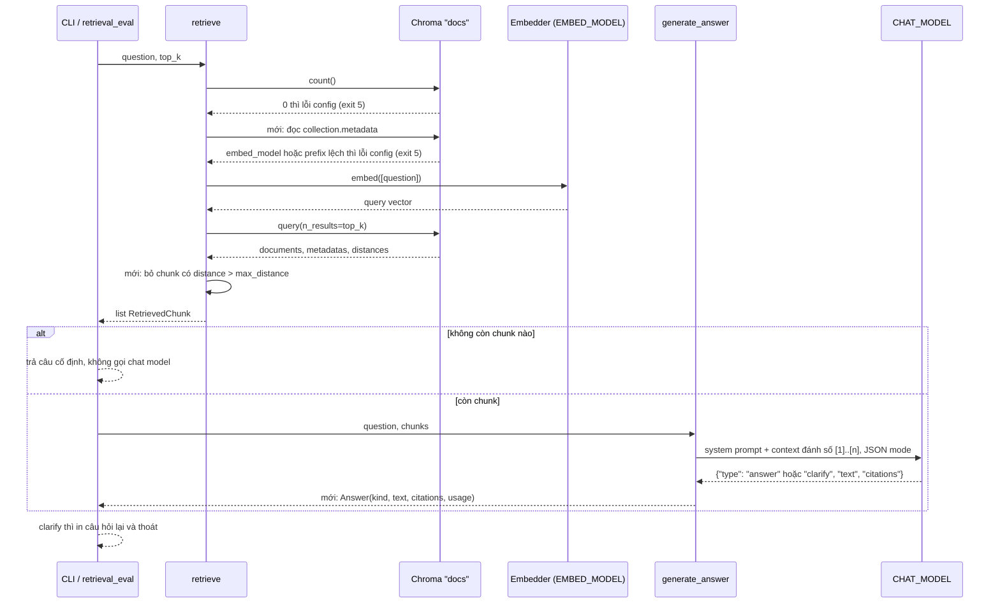

# Thiết kế retrieval pipeline

Tài liệu gồm hai phần. Phần đầu mô tả thiết kế hiện tại của `retrieval/` tại commit `a91fcbb`: embed câu hỏi, query Chroma store ở `data/chroma` lấy `top_k` chunk gần nhất, rồi gọi chat model qua OpenRouter để trả lời chỉ từ các chunk đó. Phần hai là các thay đổi pipeline đã được người dùng chốt ngày 2026-10-19: kiểm tra `EMBED_MODEL` với metadata của store, ngưỡng cosine distance để từ chối câu hỏi ngoài corpus, trích dẫn nguồn, hỏi lại khi câu hỏi mơ hồ, và ghi latency, token trong kết quả. Thiết kế đánh giá đã tách sang `docs/plans/2026-10-19-evaluation-design.md` và được hoãn tới khi xong hai pipeline. Các thay đổi chưa được implement.

## Bối cảnh và phạm vi

Retrieval chỉ đọc store mà ingestion ghi (`README.md`, `CLAUDE.md`); hai pipeline không gọi nhau, hợp đồng giữa chúng là collection Chroma. Người dùng xác nhận hai pipeline không bao giờ chạy đồng thời. Giao diện hiện có là CLI một câu hỏi: `uv run --env-file .env python main.py ask "<câu hỏi>"`, in câu trả lời và danh sách source kèm cosine distance (`main.py:60-64`). Corpus và golden set là tiếng Việt; golden set hiện có 6 câu hỏi, mỗi câu một source (`evaluation/datasets/golden.jsonl`). Giả định lập kế hoạch: corpus thật khoảng 10 văn bản nhiều định dạng (xem `docs/plans/2026-10-19-ingestion-pipeline-design.md`), số chunk (pending).

Ngoài phạm vi: cách tạo store, API server, hội thoại nhiều lượt (kể cả giữ trạng thái giữa câu hỏi lại và câu trả lời), chạy đồng thời với ingestion, thiết kế đánh giá (tài liệu riêng).

## Quyết định đã chốt

| Chủ đề | Quyết định của người dùng | Ảnh hưởng tới thiết kế |
| --- | --- | --- |
| Chạy đồng thời | retrieval và ingestion không bao giờ chạy cùng lúc | race không được xử lý, ghi thành quy tắc vận hành |
| Lệch embed model | ingestion ghi `embed_model` vào metadata collection, retrieval đọc và dừng sớm khi khác `EMBED_MODEL` | thêm bước kiểm tra trước khi embed câu hỏi |
| Câu hỏi ngoài corpus | xử lý bằng ngưỡng cosine distance | chunk vượt ngưỡng bị loại; không còn chunk nào thì trả câu cố định, không gọi chat model |
| Giá trị ngưỡng | (pending), chọn từ `retrieval_eval` | cần câu hỏi `refuse` trong golden set |
| Câu trả lời khi từ chối | giữ "Không tìm thấy thông tin trong tài liệu." | hằng số trong code |
| System prompt | giữ bằng tiếng Anh | prompt đã yêu cầu trả lời theo ngôn ngữ câu hỏi (`retrieval/pipeline.py:14`); câu từ chối là chuỗi tiếng Việt cố định |
| Đánh giá | hoãn, làm sau khi xong ingestion và retrieval | thiết kế ở `docs/plans/2026-10-19-evaluation-design.md`; pipeline chỉ cần sinh ra dữ liệu mà eval sẽ dùng |
| Trích dẫn | câu trả lời có trích dẫn `[n]` map về chunk | `Answer(kind, text, citations, ...)` |
| Clarify | xây cơ chế hỏi lại trong retrieval pipeline | mục "Hỏi lại khi câu hỏi mơ hồ" |
| Đầu ra CLI | dòng đầu có nhãn theo loại kết quả, mỗi loại một exit code | mục "Đầu ra CLI và exit code" |
| Latency, quota | chưa có ngân sách latency hay quota mỗi câu; quota là giới hạn ngày của model free tier; hết quota thì dừng ngay với lỗi rõ ràng | mục "Rate limit và hết quota" |
| Prefix embed | thêm `query: ` cho câu hỏi theo model card, ghi prefix vào metadata collection | mục "Embed câu hỏi với prefix" |

## Câu hỏi làm rõ và câu trả lời từ code

| Câu hỏi | Trả lời | Nguồn |
| --- | --- | --- |
| Retrieve bằng cách nào? | Dense search thuần, một lần query, cosine distance | `retrieval/pipeline.py:32-36`, `core.py:20` |
| Lấy bao nhiêu chunk? | `top_k`, mặc định 4; hiện chưa có ngưỡng distance | `core.py:117`, `retrieval/pipeline.py:34` |
| Có lọc metadata trước khi search không? | Không, query trên toàn collection | `retrieval/pipeline.py:32-36` |
| Model nào trả lời? | `CHAT_MODEL` trong `.env` (`.env.example`: `google/gemma-4-31b-it:free`), `temperature=0` | `core.py:111`, `retrieval/pipeline.py:50-53` |
| Khi context không có câu trả lời? | Hiện tại: prompt yêu cầu model nói không biết, code không tự chặn | `retrieval/pipeline.py:11-15` |
| Câu trả lời có trích dẫn nguồn không? | Không. `generate_answer` chỉ trả chuỗi text; CLI in source của mọi chunk đã lấy về, không phải nguồn model đã dùng | `retrieval/pipeline.py:46-58`, `main.py:61-64` |
| Có cơ chế hỏi lại khi câu hỏi mơ hồ không? | Không | `retrieval/pipeline.py:11-15` |
| `CHAT_MODEL` mặc định có hỗ trợ JSON output qua OpenRouter không? | `google/gemma-4-31b-it:free` liệt kê `response_format` (JSON mode) và `tools`, nhưng không có `structured_outputs` (JSON schema chặt), theo danh sách model công khai của OpenRouter đọc ngày 2026-10-19 | https://openrouter.ai/api/v1/models |
| Có yêu cầu latency không? | Không; người dùng xác nhận chưa có ngân sách latency hay quota mỗi câu | - |
| CLI dùng argparse không? | Có; argparse thoát với code 2 khi sai cú pháp, `SystemExit("...")` hiện tại thoát với code 1 | `main.py:105-107`, `retrieval/pipeline.py:30`, `core.py:133-136` |
| OpenAI SDK có tự retry không? | Có. `make_client` dùng mặc định (`core.py:137`): `DEFAULT_MAX_RETRIES = 2`, backoff 0.5 tới 8 giây, retry 408, 409, 429, 5xx, theo `Retry-After` nếu không quá 120 giây, không retry nếu `Retry-After` dài hơn hoặc `x-should-retry: false` (openai 3.3.0) | `.venv/lib/python3.12/site-packages/openai/_constants.py:8-13`, `.venv/lib/python3.12/site-packages/openai/_base_client.py:826-866` |
| `EMBED_MODEL` có cần prefix không? | Có theo model card: `query: ` cho câu hỏi, `passage: ` cho tài liệu, kể cả khi gọi qua endpoint `/v1/embeddings` kiểu OpenAI | https://huggingface.co/nvidia/Nemotron-3-Embed-1B-BF16 (README dòng 152 và 502, đọc 2026-10-19) |
| Chroma có giới hạn `n_results` theo số phần tử không? | Có, log warning và giảm `n_results` về số phần tử trong index | `.venv/lib/python3.12/site-packages/chromadb/segment/impl/vector/local_persistent_hnsw.py:419-424` |

## Luồng dữ liệu

Luồng sau thay đổi đã chốt; các bước đánh dấu "mới" chưa có trong code.

## Thành phần hiện tại

| Thành phần | Trách nhiệm | Phụ thuộc | Vị trí |
| --- | --- | --- | --- |
| `main` | Nhận câu hỏi từ argv, load settings, gọi `retrieve` rồi `generate_answer`, in answer và sources | settings, openrouter, store, pipeline | `main.py:45-65` |
| `retrieve` | Dừng nếu collection rỗng, embed câu hỏi, query `top_k`, trả `RetrievedChunk` | `Collection`, `Embedder` | `retrieval/pipeline.py:26-42` |
| `RetrievedChunk` | Dataclass frozen gồm `source`, `text`, `distance` | không | `retrieval/pipeline.py:18-22` |
| `generate_answer` | Ghép context dạng `[source]\ntext`, gọi chat completion, trả `""` nếu content rỗng | client OpenAI trỏ tới OpenRouter | `retrieval/pipeline.py:46-58` |
| `open_collection` | Mở collection đã lưu, `get_or_create`, không gắn embedding function | chromadb | `core.py:205-209` |
| `make_embedder` | Dùng chung với ingestion, nên query và passage cùng đi qua một hàm embed | OpenRouter | `core.py:189-201` |

`retrieve` và `generate_answer` nhận collection, embedder và client qua tham số, nên `retrieval_eval` dùng lại nguyên hai hàm này (`evaluation/retrieval_eval.py:82-83`) và test thay embedder bằng `fake_embed` (`tests/test_retrieval_pipeline.py:11-17`). Tách hai hàm cũng là điều kiện để eval sau này chạy riêng lớp generation với gold evidence (`docs/plans/2026-10-19-evaluation-design.md`, mục "Hai lớp đánh giá").

## Hợp đồng với ingestion

| Điều kiện | Ai đảm bảo | Hậu quả nếu vi phạm |
| --- | --- | --- |
| Không chạy đồng thời với ingestion | người vận hành, theo quy tắc đã chốt | không xác định: store rỗng, thiếu chunk, hoặc ingestion fail; không được xử lý |
| Cùng `chroma_dir` và `collection` | cả hai đọc từ `core.py:112-113` | đọc nhầm hoặc tạo collection rỗng mới |
| Cùng `EMBED_MODEL` và cùng cặp prefix đã build store | ingestion ghi `embed_model`, `embed_query_prefix`, `embed_passage_prefix` vào metadata collection, retrieval kiểm tra | `[ERROR CONFIG]`, exit code 5 |
| Collection dùng cosine | `COLLECTION_CONFIG` dùng chung (`core.py:20`) | distance không còn là cosine distance, ngưỡng mất ý nghĩa |
| Metadata chunk có `source` và locator (`page`/`sheet`/`slide`) | ingestion ghi | `retrieve` raise `KeyError` (`retrieval/pipeline.py:38`); không khớp được gold evidence, không trích dẫn được trang |
| `source` là path tương đối so với `data/docs` | ingestion và golden set dùng cùng quy ước (`doc_id`) | Recall@k luôn 0 |
| Store có `corpus_hash` và cấu hình chunk trong metadata collection | ingestion ghi | report eval không ghi được phiên bản corpus, không so sánh được hai lần chạy |

`RetrievedChunk` cần thêm `locator` (giá trị `page`, `sheet` hoặc `slide`, rỗng với `.md`/`.txt`/`.docx`) để vừa khớp gold evidence vừa trích dẫn được `(doc_id, page)`.

## Kiểm tra embed model khi mở store

Trước khi embed câu hỏi, `retrieve` (hoặc một hàm nhỏ trong `core.py` mà cả retrieval và `retrieval_eval` gọi) đọc `collection.metadata` và so `embed_model` với `settings.embed_model`:

| Trường hợp | Hành vi |
| --- | --- |
| Khớp | tiếp tục |
| Khác | `[ERROR CONFIG]`, exit code 5, thông báo nêu cả model của store và model hiện tại, yêu cầu chạy lại ingestion hoặc đổi `EMBED_MODEL` |
| `embed_query_prefix` của store khác `embed_query_prefix` trong `config.yaml` | `[ERROR CONFIG]`, exit code 5 |
| Store không có `embed_model` (build trước thay đổi) | `[ERROR CONFIG]`, exit code 5, yêu cầu chạy lại ingestion |

Kiểm tra chạy trước lời gọi embed, nên khi lệch model không tốn quota. Retrieval chỉ kiểm tra `embed_model`; lệch `chunk_size`, `chunk_overlap`, `chunk_strategy` không làm sai kết quả query nên do `ingestion_eval` báo. `retrieve` cần thêm tham số tên model (hoặc nhận `Settings`); đây là thay đổi chữ ký hàm, ảnh hưởng `main.py:51-54`, `evaluation/retrieval_eval.py:82` và test.

## Ngưỡng distance cho câu hỏi ngoài corpus

Giá trị ngưỡng là (pending).

- Thêm setting `max_distance` trong `config.yaml`, đọc qua `core.py`. Để `null` thì không lọc, giữ nguyên hành vi hiện tại; nhờ vậy lần đổi code này không đổi metric, và việc bật ngưỡng là một biến riêng.
- `retrieve` vẫn query `top_k` chunk rồi bỏ mọi chunk có cosine distance lớn hơn `max_distance`. Số chunk trả về có thể từ 0 tới `top_k`.
- Không còn chunk nào: trả câu cố định "Không tìm thấy thông tin trong tài liệu." và không gọi chat model. CLI in câu đó và không in mục Sources. Câu cố định là một hằng số `REFUSAL_ANSWER` trong `retrieval/pipeline.py`.
- Còn ít nhất một chunk: đi tiếp như hiện tại; prompt "say you don't know" vẫn giữ làm lớp thứ hai.

Giá trị được chọn bằng `retrieval_eval` theo quy trình ở `docs/plans/2026-10-19-evaluation-design.md`, mục "Chọn ngưỡng `max_distance`". Quy tắc "retrieval changes are eval-driven" của `CLAUDE.md` vẫn áp dụng trong lúc eval bị hoãn, nên giá trị ngưỡng, việc đổi `top_k` và các tham số retrieval khác giữ (pending) tới khi eval chạy được; tới lúc đó `max_distance` để `null` (không lọc).

## Trích dẫn nguồn trong câu trả lời

Hiện câu trả lời không có trích dẫn (`retrieval/pipeline.py:46-58`). Trích dẫn giúp người đọc kiểm tra câu trả lời, và là dữ liệu eval cần để đo Citation Precision/Recall.

- Context đánh số: mỗi chunk thành `[n] (<doc_id>, <locator>)\n<text>` thay cho `[source]\n<text>` (`retrieval/pipeline.py:49`).
- System prompt (vẫn tiếng Anh) thêm yêu cầu đặt marker `[n]` sau mỗi ý lấy từ chunk n, và liệt kê các số đã dùng trong trường `citations` của JSON output (mục "Hỏi lại khi câu hỏi mơ hồ").
- `citations` trong `Answer` là danh sách `(doc_id, locator)` không trùng, map từ số n về chunk thứ n. Lấy từ trường `citations` của JSON; thiếu trường đó thì lấy bằng regex `\[(\d+)\]` trên text. Số trỏ tới chunk không tồn tại bị bỏ và đếm vào `invalid_citations`.
- CLI in mục Sources theo `citations` thay vì mọi chunk đã lấy về.
- Câu từ chối cố định có `citations` rỗng.

Phương án "trả source của mọi chunk đã đưa vào context" bị loại: nó không cho biết model đã dùng chunk nào. Đây là thay đổi prompt; theo `CLAUDE.md` nó cần `retrieval_eval` trước và sau, nên kết quả đo của nó là (pending) tới khi eval chạy được.

## Hỏi lại khi câu hỏi mơ hồ

Người dùng chốt xây cơ chế clarify. Thiết kế đề xuất:

- Giữ single-shot, không lưu trạng thái hội thoại. Câu hỏi lại là một kết quả cuối của lần chạy; người dùng tự hỏi lại bằng câu cụ thể hơn, lần chạy sau không biết lần trước.
- Từ chối vẫn do `max_distance` quyết định trước mọi lời gọi LLM. Clarify chỉ xảy ra khi có ít nhất một chunk qua ngưỡng.
- Chat model trả JSON: `{"type": "answer" | "clarify", "text": "...", "citations": [1, 3]}`. Với `clarify`, `text` là một câu hỏi lại ngắn và `citations` là các chunk cho thấy câu hỏi có nhiều cách hiểu.
- Prompt (vẫn tiếng Anh) mô tả khi nào hỏi lại: câu hỏi khớp nhiều thực thể hoặc tài liệu khác nhau trong context (vd hai quy định cùng tên ở hai tài liệu) và mỗi cách hiểu cho câu trả lời khác nhau, đến mức gộp lại thành một câu trả lời sẽ gây hiểu nhầm. Khi các trường hợp ít và trả lời gộp được, phải trả lời cả các trường hợp thay vì hỏi lại. Ví dụ ranh giới trong corpus hiện tại: "Phụ cấp ăn uống khi đi công tác là bao nhiêu?" khớp hai mức trong `data/docs/cong-tac-phi.md` (trong nước và nước ngoài); trả lời cả hai mức là đúng, không hỏi lại. Câu hỏi lại viết theo ngôn ngữ của câu hỏi, như câu trả lời (`retrieval/pipeline.py:14`).
- Gọi chat với `response_format={"type": "json_object"}`. Model mặc định hỗ trợ tham số này nhưng không hỗ trợ JSON schema chặt (https://openrouter.ai/api/v1/models), nên JSON có thể sai cấu trúc và phải được kiểm tra. Provider free tier có thực sự áp dụng JSON mode hay không là unverified.
- Fallback khi output không phải JSON hợp lệ: nếu text bắt đầu bằng marker cố định `CLARIFY:` (prompt cũng mô tả marker này) thì là `clarify`, phần sau marker là câu hỏi lại; ngược lại coi toàn bộ text là `answer`, lấy citations bằng regex. `type` có giá trị lạ cũng coi là `answer`.
- `Answer` là dataclass frozen gồm `kind` (`answer`, `clarify`, `refuse`), `text`, `citations`, `usage`, `latency_ms`. `refuse` chỉ do ngưỡng sinh ra, với `text = REFUSAL_ANSWER` và `citations` rỗng.
- CLI: `kind = clarify` thì in câu hỏi lại, không in Sources, rồi thoát; `refuse` in câu từ chối; `answer` in câu trả lời và Sources theo `citations`. Nhãn và exit code theo mục "Đầu ra CLI và exit code".

Chi phí: không thêm lời gọi API, vẫn một lời gọi chat mỗi câu hỏi. Prompt dài thêm phần mô tả JSON và quy tắc hỏi lại, nên tốn thêm prompt token mỗi câu (số cụ thể là (pending), đo qua `usage`). JSON mode có thể ảnh hưởng chất lượng câu trả lời; chưa đo (unverified). Người dùng tốn thêm một lượt hỏi khi bị hỏi lại. Eval sau này cần thêm `clarify_accuracy` và `false_clarify_rate` (đã ghi trong evaluation doc).

Phương án đã cân nhắc:

| Phương án | Ưu | Nhược |
| --- | --- | --- |
| JSON output với trường `type` (chọn) | một lời gọi, parse rõ ràng, citations đi cùng | model free tier không có JSON schema chặt, cần validate và fallback |
| Marker text `CLARIFY:` làm cơ chế chính | không cần JSON mode | dễ lẫn với câu trả lời bình thường, citations vẫn phải parse bằng regex; giữ làm fallback |
| Gọi thêm một lần LLM để phân loại câu hỏi trước khi trả lời | tách việc phân loại khỏi việc trả lời | gấp đôi lời gọi chat mỗi câu, tốn quota free tier |
| Hỏi lại dựa trên luật (vd chunk top đến từ nhiều tài liệu) | không cần LLM | không phân biệt được hai tài liệu nói cùng một ý với hai tài liệu mâu thuẫn |

## Đầu ra CLI và exit code

Người dùng chốt: dòng đầu tiên của output cho biết ngay pipeline đã làm gì, và mỗi loại kết quả có exit code riêng để script phân biệt được.

| Kết quả | Dòng đầu | Phần sau | Stream | Exit code |
| --- | --- | --- | --- | --- |
| Trả lời | `[ANSWER]` | câu trả lời, rồi mục Sources theo `citations` | stdout | 0 |
| Hỏi lại | `[CLARIFY]` | câu hỏi lại; người dùng hỏi lại bằng câu cụ thể hơn | stdout | 3 |
| Từ chối | `[REFUSE]` | `REFUSAL_ANSWER` | stdout | 4 |
| Lỗi cấu hình hoặc store | `[ERROR CONFIG]` | thiếu `OPENROUTER_API_KEY`, store rỗng, lệch `embed_model` hoặc prefix, store thiếu metadata, key bị từ chối (401) | stderr | 5 |
| Rate limit ngắn | `[ERROR RATE_LIMIT]` | bị 429 sau khi SDK đã retry; nên chạy lại sau ít phút | stderr | 6 |
| Hết quota ngày | `[ERROR QUOTA]` | đã dùng hết giới hạn request free tier trong ngày UTC (hoặc 402 hết credit); chạy lại sau khi reset | stderr | 7 |
| Lỗi API khác | `[ERROR API]` | 5xx, 502, 503 hoặc lỗi mạng sau khi SDK đã retry, kèm HTTP status và `error.message` | stderr | 8 |

Code 1 để dành cho lỗi không lường trước (exception Python không bắt), code 2 để dành cho argparse khi sai cú pháp (`main.py:105-107`), nên không dùng hai code này cho kết quả có chủ đích. Nhãn viết ASCII cố định để `grep` được; phần nội dung giữ ngôn ngữ như hiện tại. Bảng exit code đặt trong `core.py` để ingestion dùng chung các code lỗi 5 tới 8.

Thay đổi đi kèm: các chỗ đang `raise SystemExit("...")` (`retrieval/pipeline.py:30`, `core.py:133-136`, `core.py:143-146`) đổi sang exception có loại, và chỉ `main` mới in nhãn và gọi `sys.exit` với code tương ứng. Nhờ vậy `retrieve` và `generate_answer` vẫn dùng được từ `retrieval_eval` mà không thoát process.

## Rate limit và hết quota

Người dùng chốt: chưa có ngân sách latency hay quota mỗi câu; quota là giới hạn ngày của model free tier. Khi hết quota thì dừng ngay với lỗi nói rõ đã chạm giới hạn, không retry vô hạn.

Tài liệu OpenRouter (https://openrouter.ai/docs/api-reference/limits, đọc 2026-10-19):

- Model có id kết thúc bằng `:free` bị giới hạn theo số request mỗi phút và mỗi ngày UTC; mức giới hạn ngày phụ thuộc tổng credit đã mua. Thiết kế không ghi cứng con số; số hiện tại lấy từ endpoint dưới đây.
- Chạm giới hạn trả HTTP 429 với body dạng `{"error": {"code": 429, "message": "...", "metadata": {"error_type": "rate_limit_exceeded"}}}`. Giới hạn của nền tảng kèm header `X-RateLimit-Limit`, `X-RateLimit-Remaining`, `X-RateLimit-Reset`; có thể kèm `Retry-After`. 429 cũng có thể đến từ provider phía sau, khi đó `error.metadata.provider_code` mang mã của provider nếu có.
- `GET /api/v1/key` trả `free_model_daily_requests` gồm `used`, `limit`, `remaining` cho ngày UTC hiện tại; giới hạn mỗi phút không có ở endpoint này.

Tài liệu lỗi (https://openrouter.ai/docs/api-reference/errors, đọc 2026-10-19) liệt kê 402 là hết credit, không nên chờ rồi retry. Tài liệu không nói cách phân biệt 429 do giới hạn mỗi phút với 429 do hết giới hạn ngày qua body hay header (unverified). Gọi `GET /api/v1/key` có bị tính vào giới hạn hay không cũng không được nêu (unverified).

Thiết kế:

- Retry ngắn: giữ retry của OpenAI SDK, ghi tường minh `max_retries=2` trong `make_client` và `make_async_client` (`core.py:137`, `core.py:147-149`) để giới hạn retry hiện rõ trong code. SDK retry 429 tối đa 2 lần với backoff 0.5 tới 8 giây và theo `Retry-After` tới 120 giây (`.venv/lib/python3.12/site-packages/openai/_constants.py:8-13`, `.venv/lib/python3.12/site-packages/openai/_base_client.py:826-866`). Không thêm vòng retry nào khác.
- Phân loại sau khi SDK đã hết retry và raise `openai.RateLimitError`: gọi `GET /api/v1/key` một lần. `free_model_daily_requests.remaining` bằng 0 thì là hết quota ngày (`[ERROR QUOTA]`, code 7). Còn lớn hơn 0 thì là rate limit ngắn (`[ERROR RATE_LIMIT]`, code 6). Lời gọi kiểm tra cũng lỗi thì báo `[ERROR RATE_LIMIT]` với nội dung nói rõ không xác định được là giới hạn phút hay giới hạn ngày.
- HTTP 402 (`openai.APIStatusError` với status 402) là `[ERROR QUOTA]`, code 7. 401 là `[ERROR CONFIG]`, code 5.
- Thông báo lỗi gồm HTTP status, `error.message`, `error.metadata.provider_code` nếu có, `X-RateLimit-Reset` nếu có, và `used`/`limit` từ `/api/v1/key` nếu đọc được. Không in API key.
- Hàm phân loại đặt trong `core.py`, dùng chung cho ingestion, retrieval và eval.

Chi phí: khi hết quota ngày, SDK vẫn gửi thêm tối đa 2 request bị từ chối trước khi dừng; những request đó có bị tính vào giới hạn hay không là unverified. Đổi lại không phải tự viết logic retry.

Trong retrieval, lỗi này có thể xảy ra ở lời gọi embed câu hỏi hoặc lời gọi chat; cả hai đi qua cùng cách phân loại. Với `retrieval_eval` (thuộc evaluation doc, đang hoãn): gặp lỗi quota thì dừng cả lần chạy, giữ các dòng đã ghi trong `retrieval_samples.jsonl` (hiện code đã ghi từng dòng ngay, `evaluation/retrieval_eval.py:117-119`).

## Quyết định thiết kế và phương án đã cân nhắc

### Số chunk và ngưỡng

| Phương án | Ưu | Nhược |
| --- | --- | --- |
| `top_k` cố định, không ngưỡng (hiện tại) | đơn giản, một biến để ablation | luôn đưa chunk vào context kể cả khi không liên quan |
| `top_k` cộng ngưỡng distance (đã chốt) | từ chối câu ngoài corpus mà không tốn lời gọi chat | ngưỡng phụ thuộc embed model, cần câu `refuse` trong golden set để chọn |
| `top_k` động theo độ dài context | tận dụng context window | khó so sánh giữa các lần eval |

Corpus hiện chỉ có 3 chunk (`evaluation/reports/ingestion.json`: `"expected_chunks": 3`) trong khi `top_k: 4`, nên mọi câu hỏi nhận toàn bộ corpus làm context và Chroma log warning (`.venv/lib/python3.12/site-packages/chromadb/segment/impl/vector/local_persistent_hnsw.py:419-424`). Với corpus thật khoảng 10 văn bản, `top_k: 4` chỉ có ý nghĩa khi số chunk (pending) lớn hơn 4; giữ `top_k: 4` cho tới khi có baseline trên corpus thật, mọi thay đổi `top_k` qua `retrieval_eval`.

### Một lần retrieve thay vì agentic

Pipeline là một lần embed và một lần query, không viết lại câu hỏi, không retry, không tách câu hỏi con. Chỉ cân nhắc query rewriting hoặc decomposition khi nhóm `multi-hop` và `comparison` trong golden set có `Recall@k` hoặc `all_evidence_hit@k` thấp hơn rõ so với nhóm `factoid`.

### Prompt và định dạng context

System prompt yêu cầu chỉ dùng context, nói không biết nếu thiếu, trả lời cùng ngôn ngữ câu hỏi (`retrieval/pipeline.py:11-15`). Người dùng chốt giữ prompt bằng tiếng Anh; câu "Answer in the same language as the question." đã có (`retrieval/pipeline.py:14`), nên không cần sửa cho yêu cầu này. `temperature=0` để kết quả eval ổn định hơn giữa các lần chạy (`retrieval/pipeline.py:52`). Không khử trùng lặp phần chồng lấn giữa các chunk liền kề. Thay đổi prompt đã chốt là yêu cầu trích dẫn `[n]`, output JSON và quy tắc hỏi lại ở hai mục trên.

### Embed câu hỏi với prefix

Hiện câu hỏi đi qua cùng `make_embedder` với passage, không có prefix (`retrieval/pipeline.py:33`, `core.py:189-201`). Model card của Nemotron 3 Embed 1B yêu cầu thêm `query: ` trước câu hỏi và `passage: ` trước tài liệu, và nói rõ khi gọi qua endpoint `/v1/embeddings` kiểu OpenAI thì phải tự thêm prefix vào `input` (https://huggingface.co/nvidia/Nemotron-3-Embed-1B-BF16, README dòng 152 và 502, đọc 2026-10-19). Danh sách model của OpenRouter không có tham số nào cho embedding model này (`supported_parameters: []`), nên không có cách khác ngoài tự thêm prefix (https://openrouter.ai/api/v1/embeddings/models, đọc 2026-10-19).

Thiết kế: thêm setting `embed_query_prefix` (mặc định `query: `, có dấu cách cuối) và `embed_passage_prefix` (mặc định `passage: `) trong `config.yaml`, đọc qua `core.py`. Retrieval embed `embed_query_prefix + question`; ingestion embed `embed_passage_prefix + text` nhưng lưu text không có prefix. Ingestion ghi cả hai prefix vào metadata collection; retrieval so `embed_query_prefix` của store với setting hiện tại cùng lúc kiểm tra `embed_model`, lệch thì `[ERROR CONFIG]`, code 5. Đổi `EMBED_MODEL` sang model khác thì phải đặt lại hai prefix theo model card của model đó.

Hai điều chưa chắc: OpenRouter để `hugging_face_id` là `null` cho `nvidia/nemotron-3-embed-1b:free`, nên việc model OpenRouter phục vụ đúng là checkpoint trên Hugging Face là suy ra từ tên (unverified); OpenRouter có tự thêm prefix phía server hay không cũng không được nêu (unverified). Thêm prefix là thay đổi cách retrieve, nên theo `CLAUDE.md` cần `retrieval_eval` trước và sau; eval đang hoãn và store chưa từng được build (`evaluation/reports/ingestion.json`: `"stored_chunks": 0`), nên đề xuất làm theo model card ngay từ lần build đầu và để eval xác nhận sau.

## Failure modes

| Tình huống | Hành vi | Nguồn |
| --- | --- | --- |
| Thiếu `OPENROUTER_API_KEY` | hiện tại: `SystemExit` code 1 trước khi mở store. Sau thay đổi: `[ERROR CONFIG]`, code 5 | `core.py:132-136`, `main.py:52` |
| Store chưa build hoặc rỗng | hiện tại: `SystemExit` code 1 với thông báo "Vector store is empty; run \`python main.py ingest\` first"; `open_collection` dùng `get_or_create` nên vẫn tạo một collection rỗng trên đĩa. Sau thay đổi: `[ERROR CONFIG]`, code 5 | `retrieval/pipeline.py:29-30`, `core.py:207`, `tests/test_retrieval_pipeline.py:20-22` |
| Ingestion đang chạy | không xử lý theo thiết kế; điều kiện tiên quyết là không chạy đồng thời | `core.py:207`, `core.py:238-245` |
| Lệch `EMBED_MODEL` với store | sau thay đổi: `[ERROR CONFIG]`, code 5, nêu cả hai model, trước khi gọi API | `retrieval/pipeline.py:32-36` |
| Store build trước thay đổi, không có metadata | sau thay đổi: `[ERROR CONFIG]`, code 5, yêu cầu chạy lại ingestion | metadata collection |
| `top_k` lớn hơn số chunk | Chroma log warning và trả về toàn bộ chunk hiện có | `.venv/lib/python3.12/site-packages/chromadb/segment/impl/vector/local_persistent_hnsw.py:419-424` |
| Câu hỏi ngoài corpus | sau thay đổi: không chunk nào qua ngưỡng thì trả câu cố định | mục "Ngưỡng distance" |
| Ngưỡng quá chặt hoặc quá lỏng | từ chối nhầm hoặc để lọt; eval sau này đo bằng `false_refusal_rate` và `refusal_accuracy` | evaluation doc |
| Đổi `EMBED_MODEL` mà giữ ngưỡng cũ | thang distance khác, ngưỡng sai mà không báo lỗi | phải chọn lại ngưỡng |
| Model không đặt marker `[n]` hoặc đặt số sai | `citations` rỗng hoặc thiếu; marker sai bị bỏ và đếm vào `invalid_citations` | mục "Trích dẫn nguồn" |
| Câu hỏi mơ hồ | hiện tại: trả lời theo một cách hiểu. Sau thay đổi: model trả `type = clarify`, CLI in câu hỏi lại | mục "Hỏi lại khi câu hỏi mơ hồ" |
| Model hỏi lại quá mức với câu hỏi rõ ràng | người dùng phải hỏi lại không cần thiết; prompt yêu cầu ưu tiên trả lời gộp; eval sau này đo bằng `false_clarify_rate` | mục "Hỏi lại khi câu hỏi mơ hồ" |
| Output không phải JSON hợp lệ hoặc `type` lạ | marker `CLARIFY:` thì là clarify, ngược lại coi là `answer`, citations lấy bằng regex | mục "Hỏi lại khi câu hỏi mơ hồ" |
| Provider bỏ qua `response_format` | model trả text tự do; xử lý như output không hợp lệ | unverified |
| Chat model trả `clarify` nhưng `text` rỗng | coi là `answer` rỗng, giống trường hợp content rỗng | `retrieval/pipeline.py:58` |
| 429 giới hạn mỗi phút | SDK retry tối đa 2 lần; vẫn lỗi thì `[ERROR RATE_LIMIT]`, code 6 | `.venv/lib/python3.12/site-packages/openai/_base_client.py:858-860` |
| Hết giới hạn request free tier trong ngày, hoặc 402 | dừng ngay sau retry của SDK, `[ERROR QUOTA]`, code 7, thông báo nói rõ đã chạm giới hạn ngày | mục "Rate limit và hết quota" |
| 5xx, 502, 503, lỗi mạng | SDK retry tối đa 2 lần; vẫn lỗi thì `[ERROR API]`, code 8 | `.venv/lib/python3.12/site-packages/openai/_base_client.py:863-865` |
| Lệch prefix embed giữa store và setting | `[ERROR CONFIG]`, code 5 | mục "Embed câu hỏi với prefix" |
| Chat model trả content rỗng | trả `""`, CLI in dòng trống | `retrieval/pipeline.py:58` |

## Đánh giá

Thiết kế đánh giá (corpus cố định, schema ground truth, metric lớp retrieval và generation, judge, baseline, thay đổi trong `evaluation/`) nằm ở `docs/plans/2026-10-19-evaluation-design.md`, trạng thái hoãn tới khi xong ingestion và retrieval. `evaluation/retrieval_eval.py` hiện có vẫn chạy được trên pipeline hiện tại, nhưng sẽ phải sửa khi `generate_answer` trả `Answer` thay cho chuỗi (`evaluation/retrieval_eval.py:83`).

Retrieval pipeline phải sinh ra các dữ liệu sau để eval xây được sau này:

| Dữ liệu | Ở đâu | Eval dùng cho |
| --- | --- | --- |
| `kind` (`answer`, `clarify`, `refuse`) | `Answer` | refusal accuracy, false refusal rate, clarify accuracy, false clarify rate |
| `citations` là `(doc_id, locator)` | `Answer` | citation precision và recall |
| `doc_id`, `locator`, `distance` của từng chunk lấy về, trước khi lọc ngưỡng | `RetrievedChunk`, danh sách trước khi lọc | recall@k, precision@k, MRR, chọn ngưỡng |
| `usage` (prompt token, completion token; `null` nếu provider không trả, unverified) | `Answer` | token mỗi câu |
| `latency_ms` cho retrieve và generate | `Answer`, đo bằng `time.perf_counter` | latency |
| `REFUSAL_ANSWER` là hằng số | `retrieval/pipeline.py` | nhận diện từ chối theo quy tắc |

Đọc `usage` có sẵn trong response và đo thời gian bằng `time.perf_counter` gần như không tốn gì, nên làm luôn cùng thay đổi pipeline. Để eval lấy được danh sách trước khi lọc ngưỡng, `retrieve` trả cả danh sách gốc cùng danh sách đã lọc (hoặc trả danh sách gốc và để một hàm riêng lọc).

## Thay đổi code cần làm

| File | Thay đổi |
| --- | --- |
| `core.py:55-127` | thêm `max_distance` (mặc định `null`, không lọc), `embed_query_prefix`, `embed_passage_prefix` |
| `core.py:131-201` | `max_retries=2` tường minh; nhận prefix khi embed; hàm phân loại lỗi API (rate limit, quota, config, API) có gọi `GET /api/v1/key`; exception có loại thay cho `SystemExit` |
| `core.py` (`ErrorKind`, `CliError`) | bảng exit code và nhãn dùng chung |
| `core.py` | hàm đọc và kiểm tra `embed_model` trong metadata collection |
| `retrieval/pipeline.py:11-15` | prompt thêm trích dẫn `[n]`, output JSON, quy tắc hỏi lại, marker `CLARIFY:`; thêm `REFUSAL_ANSWER` |
| `retrieval/pipeline.py:18-22` | `RetrievedChunk` thêm `locator`; thêm dataclass frozen `Answer` |
| `retrieval/pipeline.py:26-42` | kiểm tra `embed_model`, đọc locator từ metadata, lọc theo `max_distance`, giữ danh sách trước khi lọc |
| `retrieval/pipeline.py:46-58` | context đánh số, `response_format` JSON, parse và fallback, map citations, trả `Answer` kèm `usage` và `latency_ms` |
| `main.py:45-65` | in nhãn dòng đầu, Sources theo `citations`, bắt exception có loại và thoát với exit code theo bảng |
| `evaluation/retrieval_eval.py:82-84` | sửa tối thiểu để đọc `Answer.text` thay cho chuỗi, giữ eval hiện có chạy được |

## Test cần thêm

Mọi test không gọi mạng; chat model được thay bằng hàm giả trả output cố định, giống cách `fake_embed` thay embedder.

- Lệch `embed_model` hoặc thiếu metadata thì lỗi config trước khi gọi embedder.
- `max_distance` là `null` thì trả đủ `top_k` chunk như cũ; mọi chunk vượt ngưỡng thì `kind = refuse`, `text = REFUSAL_ANSWER` và chat model không được gọi.
- JSON `type = answer` với `citations: [1, 3]` map đúng `(doc_id, locator)`; số 9 khi chỉ có 4 chunk bị bỏ và đếm vào `invalid_citations`.
- JSON `type = clarify` cho `kind = clarify`, CLI in câu hỏi lại và không in Sources.
- Output không phải JSON: bắt đầu bằng `CLARIFY:` thì là clarify; text thường thì là `answer` và citations lấy bằng regex `[n]`; `type` lạ thì là `answer`.
- `usage` thiếu trong response thì `Answer.usage` là `None`, không lỗi.
- CLI in đúng nhãn dòng đầu và thoát đúng code cho từng loại: 0, 3, 4, 5, 6, 7, 8.
- Phân loại lỗi: 429 khi `/api/v1/key` trả `remaining = 0` là quota (7); `remaining > 0` là rate limit (6); `/api/v1/key` cũng lỗi thì là rate limit với thông báo không xác định; 402 là quota; 401 là config; thông báo lỗi không chứa API key. Dùng response giả, không gọi mạng.
- Câu hỏi được embed với `embed_query_prefix`; store có `embed_query_prefix` khác setting thì lỗi config trước khi embed.

## Nâng cấp có điều kiện

Không mục nào dưới đây là mặc định (`CLAUDE.md`). Mỗi mục chỉ đề xuất khi eval chỉ ra retrieval là nút thắt; tên metric trong cột điều kiện theo `docs/plans/2026-10-19-evaluation-design.md`.

| Nâng cấp | Điều kiện kích hoạt | Chi phí |
| --- | --- | --- |
| Re-ranking bằng cross-encoder | `precision@k` hoặc `mrr` thấp trong khi `recall@k` cao, và `answer_accuracy` ở `gold` cao hơn rõ ở `e2e` | thêm latency mỗi câu hỏi, dependency model (local hoặc API), cần model hỗ trợ tiếng Việt; thêm quota nếu dùng API; ngưỡng phải chọn lại; metric lớp retrieval tính trước và sau rerank |
| Hybrid search với BM25 | câu hỏi trượt vì từ khoá chính xác (số tiền, tên quy định, mã, giá trị trong bảng Excel) mà dense search bỏ lỡ, thấy được qua `recall@k` thấp ở nhóm `table` hoặc trong `retrieval_samples.jsonl` | dependency mới, index thứ hai phải đồng bộ với ingestion; không dùng tokenizer hay stemmer tiếng Anh, cần tách âm tiết hoặc từ ghép tiếng Việt và text đã chuẩn hoá NFC; ngưỡng distance không áp dụng trực tiếp cho điểm fusion |
| Lọc metadata trước khi search | corpus có nhiều nhóm tài liệu và câu hỏi chỉ thuộc một nhóm | ingestion phải ghi thêm metadata, câu hỏi phải mang thông tin lọc |
| Query rewriting hoặc decomposition | `recall@k` hoặc `all_evidence_hit@k` ở nhóm `multi-hop`, `comparison` thấp hơn rõ nhóm `factoid` | thêm một hoặc nhiều lời gọi chat mỗi câu hỏi, tốn quota free tier |
| `gather()` trong `retrieval_eval` (`# ponytail` ở `evaluation/retrieval_eval.py:79`) | chuyển sang gói OpenRouter trả phí | dễ chạm rate limit nếu vẫn ở free tier |
| Đổi vector store | Chroma trên đĩa không đáp ứng kích thước corpus | migration, dependency mới, viết lại `core.py` |

## Câu hỏi đã trả lời

- Corpus dự kiến: khoảng 10 văn bản, số chunk (pending); giữ `top_k: 4` tới khi có baseline trên corpus thật.
- Chạy đồng thời với ingestion: không.
- Phát hiện lệch embed model: có, qua `embed_model` trong metadata collection, retrieval dừng sớm.
- Câu hỏi ngoài corpus: ngưỡng cosine distance, không qua ngưỡng thì trả câu cố định; giá trị ngưỡng (pending).
- Câu trả lời cố định khi từ chối: giữ "Không tìm thấy thông tin trong tài liệu."
- System prompt: giữ bằng tiếng Anh; prompt đã yêu cầu trả lời theo ngôn ngữ câu hỏi.
- Đánh giá: hoãn tới khi xong ingestion và retrieval; thiết kế ở `docs/plans/2026-10-19-evaluation-design.md`. Các câu hỏi về metric mục tiêu, golden set, judge chuyển sang tài liệu đó.
- Clarify: có, xây trong retrieval pipeline theo dạng single-shot với JSON output `type = answer | clarify`.
- Đầu ra CLI: nhãn dòng đầu theo loại kết quả và exit code riêng (bảng ở mục "Đầu ra CLI và exit code").
- Latency và quota mỗi câu: chưa có ngân sách; quota là giới hạn ngày của free tier; hết quota thì dừng ngay với lỗi rõ ràng. Re-ranking và query rewriting vẫn là nâng cấp có điều kiện theo eval.
- Prefix của embed model: có, `query: ` và `passage: ` theo model card, ghi vào metadata collection. Giới hạn đầu vào 32768 token (mục tương ứng trong ingestion doc).

## Câu hỏi mở

- OpenRouter có phục vụ đúng checkpoint `nvidia/Nemotron-3-Embed-1B-BF16` và không tự thêm prefix phía server không? Tài liệu công khai không nêu (unverified); cần kiểm tra bằng eval khi eval chạy được.
- 429 do giới hạn phút và 429 do hết giới hạn ngày có khác nhau ở body hoặc header không, và gọi `GET /api/v1/key` có bị tính vào giới hạn không? Tài liệu không nêu (unverified); cách phân loại hiện dựa vào `free_model_daily_requests.remaining`.
